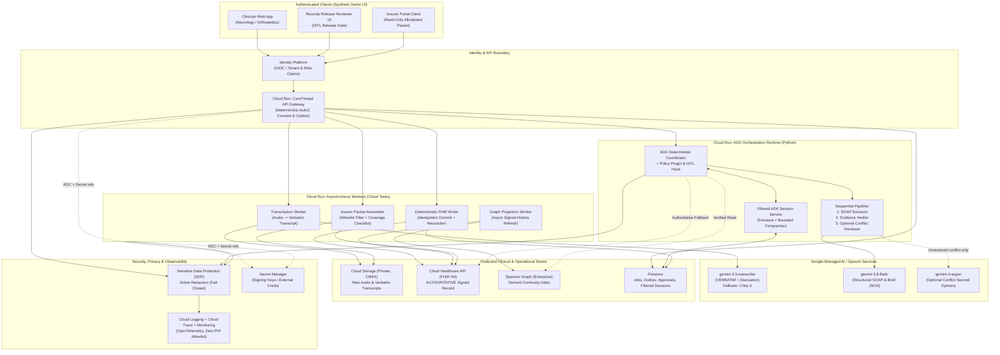

# CareThread — High-Level Architecture (L200 Proposal)

> **Document Status:** Documentation-only L200 architectural proposal (design stage).  
> **Scope Boundary:** No executable application code, scaffolding, provisioning, deployment, or live demo assets are included in this deliverable. All patient, clinician, and insurer examples use synthetic fixtures with zero real patient data.

---

## 1. One-Page Executive Narrative

**CareThread** is a Google-only clinical documentation and longitudinal continuity assistant designed to close the information gap across specialty handoffs while preserving clinical accountability, strict tenant isolation, and patient consent.

In clinical practice, unstructured visit conversations contain critical longitudinal context—functional limitations, medication discussions that are *not* yet prescriptions, lifestyle guidance, and follow-up plans—that is routinely lost or distorted when a patient transitions between specialists. CareThread addresses this in three tightly bounded workflows:

1. **Evidence-Linked Visit Documentation (31 January — Neurology):** A synthetic patient (`PT-SYN-0001`) consults a neurologist for radiating low back pain. CareThread ingests a short two-person synthetic audio recording into private encrypted storage, transcribes it verbatim with reviewable speaker diarization and word timestamps (`gemini-3.5-transcribe` in `VERBATIM` mode), and uses a deterministic **Google ADK for Python** orchestration pipeline backed by `gemini-3.8-flash` (with strict JSON response schemas) to generate an evidence-linked SOAP draft. Every clinical claim cites a stable transcript segment ID and timestamp range. A clinician verifies speaker roles, corrects any draft items, and signs the exact version and cryptographic digest before deterministic backend services commit the signed record to **Cloud Healthcare API (FHIR R4)**.
2. **Longitudinal Continuity Retrieval (31 March — Orthopedics):** Two months later, an authorized orthopedic clinician opens the same patient's longitudinal history. After deterministic server-side authorization and consent verification, CareThread retrieves bounded, dated, patient-first continuity facts from a **Spanner Graph** projection (verified against current FHIR R4 `meta.versionId` versions, with authoritative FHIR R4 fallback on staleness or failure). The March clinician sees what was reported, advised, or prescribed in January—explicitly separated from the March assessment and with clear medication semantics (a medication *discussed* in January is never represented as active current use).
3. **Purpose-Bound Insurer Release (Synthetic Demo):** Under a time-bounded, purpose-bound grant with explicit patient authorization and a mandatory human release decision, CareThread assembles an **allowlisted signed-record packet** exclusively from signed FHIR R4 resources. It optionally computes a deterministic **documentation checklist completeness score** (`numerator`, `denominator`, and `missing_items` based solely on documentation coverage). Individual health scoring, claims adjudication, eligibility determinations, premium calculation, and underwriting are strictly out of scope and prohibited by architecture and policy.

**Core Architectural Invariants (shared across all CareThread documents):**
- **Source of Truth:** Cloud Healthcare API **FHIR R4** is the sole clinical system of record for signed documentation. Spanner Graph is an eventually consistent, derived continuity index—never the authoritative store and never the authorization boundary.
- **Deterministic Boundaries:** All authentication, tenant isolation, consent checks, FHIR R4 writes, approval token verification, and insurer packet filtering execute in deterministic Cloud Run services and workers—never inside LLM prompts or model-controlled logic.
- **Clinical Sign-Off & Release Gates:** No draft becomes a signed clinical record, and no insurer packet leaves the tenant boundary, without a durable Human-in-the-Loop (HITL) confirmation bound to the exact artifact version and SHA-256 digest.
- **Zero-PHI Routine Telemetry:** Raw prompts, patient identifiers, transcripts, model outputs, and audio object paths are excluded from routine Cloud Logging, Cloud Trace attributes, and general ADK session memory. Residual permitted free text is actively scrubbed via **Sensitive Data Protection (SDP)** before persistence, failing closed if SDP is unavailable.

---

## 2. Reference Repositories & Inherited Patterns

CareThread carries forward product ideas and AgentOps patterns from two read-only public references without reusing repository-specific infrastructure, project identifiers, or deployment scripts:

| Reference Repository | Product / AgentOps Patterns Carried Forward | Explicitly Excluded | Inspection Note |
| :--- | :--- | :--- | :--- |
| **PocketSage** (`https://github.com/The-Liberal-Labs/PocketSage`) | Speaker-labelled appointment transcription; dual-view Gemini summarization (clinician SOAP + concise continuity brief); user-to-appointment graph concept elevated into a tenant-scoped clinical continuity graph. | Any repository-specific mobile/local storage layout, project IDs, or deployment scripts. | Direct GitHub API file-tree retrieval was blocked by environment policy during this documentation-only session; exact file-level line citations should be confirmed in a network-enabled review prior to implementation. |
| **ADK Healthcare Agent** (`https://github.com/phanisagiraju-byte/adk-healthcare-agent`) | ADK multi-agent orchestration, critical verification loop, durable session state, explicit clinician sign-off pattern, and golden-dataset evaluation structure. | Scheduling-first scope, repository-specific project IDs, IAM bindings, and deployment scripts. | Direct GitHub API file-tree retrieval was blocked by environment policy during this documentation-only session; exact file-level line citations should be confirmed in a network-enabled review prior to implementation. |

---

## 3. Core User Journeys

### Journey A — 31 January Neurology Visit (Capture, Draft, Verify & Sign)
1. **Capture & Upload:** Neurologist authenticates via Identity Platform, starts encounter `ENC-2026-0131-NEURO`, and uploads a short two-person synthetic audio recording directly to a private, CMEK-encrypted Cloud Storage bucket via a short-lived signed URL.
2. **Asynchronous Transcription & SOAP Drafting:** A Cloud Tasks worker invokes `gemini-3.5-transcribe` (`VERBATIM` mode, diarization + word timestamps) and stores the raw transcript artifact in private encrypted storage. The ADK Coordinator runs a sequential pipeline (`Extraction -> Evidence Verification -> Optional Conflict Review`) using `gemini-3.8-flash` to produce a schema-validated SOAP draft covering chief complaints, functional limits, stated exam findings, clinician assessment, medication discussions, diet/physical activity advice, and follow-up.
3. **Speaker Role Verification & Clinician Sign-Off:** The neurologist reviews speaker labels (`SPEAKER_1` / `SPEAKER_2` mapped to clinician vs. patient), inspects evidence-linked claims and review flags, edits if needed, and executes a durable HITL sign-off bound to `(draft_id, draft_version, sha256_digest)`.
4. **Authoritative Commit & Async Graph Refresh:** The deterministic FHIR Writer commits the signed `Composition`, `Condition`, `Observation`, `MedicationStatement`/`MedicationRequest` (only when explicitly prescribed), and `Provenance` resources to FHIR R4, writes a transactional outbox record, and enqueues an asynchronous Cloud Tasks job to refresh Spanner Graph.

### Journey B — 31 March Orthopedic Continuity Visit (Authorized Retrieval & Separation)
1. **Authorization & Consent Check:** Orthopedic clinician authenticates for encounter `ENC-2026-0331-ORTHO`. The deterministic Policy & Auth Service verifies tenant membership, legitimate care relationship, and active patient consent before any graph or FHIR read occurs.
2. **Bounded Continuity Retrieval & Verification:** The Retrieval Service queries Spanner Graph with a patient-first, tenant-scoped, hop-bounded GQL traversal, then validates returned FHIR resource references against current FHIR R4 `meta.versionId` values. If the graph is absent, stale, or unavailable, the service transparently falls back to authoritative FHIR R4 queries.
3. **Evidence-Linked Continuity Brief:** CareThread presents January's signed history—explicitly dated (`2026-01-31`), attributed to Neurology, linked to signed FHIR Provenance/transcript evidence, and visually and structurally separated from the March orthopedic assessment. Medications discussed in January appear with status `discussed` (never inferred as active prescriptions).

### Journey C — Synthetic Insurer Release (Purpose-Bound Packet + Coverage Checklist)
1. **Grant Creation & Patient Authorization:** A synthetic insurer requests documentation under a purpose-bound, expiring grant (e.g., `purpose=prior_auth_documentation`, TTL 72 hours) backed by explicit patient consent.
2. **Human Release Decision (HITL):** An authorized clinical records reviewer inspects the allowlisted signed-record packet preview and the deterministic documentation checklist completeness score (`numerator / denominator` + `missing_items`) and signs a durable release confirmation bound to `(packet_id, packet_version, sha256_digest)`.
3. **Allowlisted Delivery:** Only the allowlisted signed-record packet and coverage checklist are released. No raw audio, unsigned drafts, internal session state, health risk scores, claims decisions, eligibility flags, or underwriting outputs exist in or leave the system.

---

## 4. High-Level Component & Data-Flow Architecture

---

## 5. Google-Managed Technology Stack & Official Citations

All infrastructure and model services are Google-managed. Model IDs, launch stages, endpoints, and limits below reflect current official Google documentation as of November 2026; items marked **[Verify at Build]** must be confirmed against target project quotas, regional BAA eligibility, and IAM permissions before provisioning.

| Layer | Google Service / Tool | Model ID / Configuration | Launch Stage, Endpoint & Limits (Official Docs) | CareThread Role |
| :--- | :--- | :--- | :--- | :--- |
| **Audio Transcription (Primary)** | Vertex AI / Gemini Enterprise Agent Platform | `gemini-3.5-transcribe` (`VERBATIM` mode) | **GA**. Unary prerecorded audio up to 1 hr; **capped at 30 min** when speaker diarization or word-level timestamps are enabled. 85+ languages. Live variant (`-live`) capped at 10 min without native diarization/word timestamps (not used in MVP). **[Verify at Build: regional residency & BAA coverage]** | Prerecorded short two-person synthetic clinic audio -> verbatim transcript with diarization & word timestamps. |
| **Audio Transcription (Fallback)** | Cloud Speech-to-Text V2 | `chirp_3` (`BatchRecognize` only) | **GA** (select locales in Preview). Diarization supported **only in `BatchRecognize`** with explicit `SpeakerDiarizationConfig`; not supported in streaming/short sync. Word timestamps may slightly affect WER; confidence scores are non-statistical placeholders. Available in `us`, `eu`, and select regions. | Deterministic Google-managed fallback if `gemini-3.5-transcribe` is unavailable or quota-limited. |
| **Clinical Extraction & Brief** | Vertex AI / Google Gen AI SDK | `gemini-3.8-flash` (`response_schema` enforced) | **GA**. Global & multi-region (`us`, `eu`). `GenerateContent` / Interactions APIs. **1,048,576** input token context; **65,536** max output tokens. Thinking levels: `LOW`, `MEDIUM` (default), `HIGH` (`MINIMAL` invalid). Structured JSON output fully supported. | SOAP draft extraction, evidence-ID linking, and optional continuity brief generation. |
| **Optional Conflict Reviewer** | Vertex AI / Google Gen AI SDK | `gemini-4-argon` | **Available** on Vertex AI (paid/enterprise tiers; **[Verify at Build: project allowlist & regional availability]**). Unified **1,048,576** token budget; 65,536 default output (up to 1M via long decode). Thinking levels `LOW`/`MEDIUM`/`HIGH`; custom temperature ignored. | Invoked **only** on unresolved evidence/negation conflicts, and **only if** it beats `gemini-3.8-flash` in measured offline evaluation. |
| **Agent Framework & CLI** | Google ADK for Python + Google Agents CLI (`agents-cli`, `adk`) | `adk` runner, `BasePlugin`, `EventsCompactionConfig`, `request_confirmation` | Official Google open-source ADK & CLI toolchain for ADLC, evaluation (`adk eval`), and structured orchestration. | Deterministic coordinator, sequential pipeline, policy plugin, HITL confirmation hooks, and local/CI evals. |
| **Authoritative Clinical Store** | Cloud Healthcare API | **FHIR R4** (`enableResourceVersioning = true`) | **GA**. Individual resource max **10 MB**; transaction bundle max **50 MB**. Supports `meta.versionId`, `vread`, `_history`, `If-Match` optimistic concurrency, and `_revinclude=Provenance:target`. Regional dataset pinning (e.g., `us-central1`). | System of record for signed clinical encounters, SOAP compositions, conditions, observations, medications, and provenance. |
| **Continuity Graph Index** | Cloud Spanner Graph | Enterprise / Enterprise Plus edition; ISO GQL & `CREATE PROPERTY GRAPH` | **GA** (requires Enterprise or Enterprise Plus). Provisioned compute (Processing Units) + storage; no permanent free tier. Up to 100 MB row size; strong consistency for graph writes. | Derived, tenant-scoped patient continuity index for fast multi-visit bounded traversal. |
| **Operational State & Sessions** | Cloud Firestore | Native mode (regional) | **GA**. Serverless pay-per-operation; **1 MiB** max document size; 1 write/sec sustained per document. | Job state machine, transactional outbox, HITL approval records, consent/grant metadata, and filtered ADK session state. |
| **Raw Media & Artifacts** | Cloud Storage | Private buckets, Uniform Bucket-Level Access, CMEK | **GA**. Object versioning, lifecycle retention policies, signed URLs. | Encrypted storage for raw audio recordings, verbatim transcript JSON, and signed insurer packet archives. |
| **Compute & Async Queuing** | Cloud Run + Cloud Tasks | Dedicated per-service identities (ADC) | **GA**. Serverless containers, IAM-authenticated service-to-service invocation, Cloud Tasks deduplication & retry queues. | Stateless API gateway, ADK runtime, and isolated background workers. |
| **Identity, Privacy & Secrets** | Identity Platform + Sensitive Data Protection (SDP) + Secret Manager | OIDC/RBAC claims; `content.deidentify`; ADC + Secret Manager refs | **GA**. SDP enforces regional endpoints and RPM/quota tokens (`dlp.googleapis.com/quota_tokens`); targeted `infoTypes` required for low latency. | Tenant/role auth, active PHI redaction for telemetry/residual text, and zero-hardcoded-secret management. |
| **Observability & IaC** | Cloud Logging, Cloud Trace, Cloud Monitoring, OpenTelemetry, Terraform (Google Provider), Cloud Build, Artifact Registry | OTel W3C TraceContext; Terraform declarative IaC | **GA**. Standard Google Cloud operations and supply-chain services. | Structured JSON logging, distributed tracing, SLO alerting, reproducible IaC, and CI/CD eval gates. |

---

## 6. Key Architectural Decisions & Trade-Offs

| ID | Decision | Rationale | Trade-Off / Mitigation |
| :--- | :--- | :--- | :--- |
| **AD-01** | **FHIR R4 as Sole Signed Record; Spanner Graph as Derived Index** | Healthcare interoperability, auditability (`Provenance`), and optimistic concurrency (`If-Match`) are native to FHIR R4, whereas multi-hop cross-specialty continuity queries are ergonomic and bounded in ISO GQL. | Introduces eventual consistency between FHIR commit and graph availability. Mitigated via transactional outbox, `fhir_version_id` freshness checks, and automatic authoritative FHIR R4 fallback. |
| **AD-02** | **Prerecorded `gemini-3.5-transcribe` (`VERBATIM`) over Live Streaming** | Clinical evidence linking requires word-level timestamps and speaker diarization, which are supported in prerecorded `VERBATIM` mode (up to 30 min) and absent in `-live` (10 min cap). | Slight post-visit latency vs. real-time captions. Acceptable for MVP short two-person visits; diarization remains explicitly reviewable by the clinician. |
| **AD-03** | **Deterministic Services Own AuthZ, Consent, FHIR Writes & Release** | LLMs treat transcripts and prior notes as untrusted text and are susceptible to prompt injection or schema drift. Keeping writes and access control in deterministic Cloud Run services guarantees hard security boundaries. | Slightly more boilerplate tool contracts; fully justified for clinical safety and rubric compliance. |
| **AD-04** | **Least-Privilege Dedicated Service Identities (ADC) per Component** | Separating identities (`sa-api`, `sa-adk-runtime`, `sa-worker-transcribe`, `sa-worker-fhir`, `sa-worker-graph`, `sa-worker-release`) ensures the ADK runtime has **zero write permission** to FHIR R4 and **zero read permission** to raw audio buckets. | Requires disciplined Terraform IAM modules; prevents lateral movement and accidental unauthorized writes. |
| **AD-05** | **Fail-Closed Telemetry Scrubbing with Allowlist-First Design** | Allowlisting structural telemetry fields eliminates 95%+ of PHI leakage risk at zero latency cost; SDP scrubs only permitted residual free-text fields (e.g., error summaries) before persistence. | If SDP is unavailable, residual free text is dropped/quarantined rather than logged raw, reducing temporary debug verbosity in exchange for strict privacy preservation. |
| **AD-06** | **Gated Optional Use of `gemini-4-argon`** | `gemini-3.8-flash` handles >90% of structured SOAP drafting at lower latency and cost. Escalating to `gemini-4-argon` is reserved strictly for unresolved evidence/negation conflicts and gated on offline eval proof. | Adds routing complexity; bounded to at most 1 escalation per draft to cap cost and latency. |

---

## 7. Alternatives Considered

1. **Spanner Graph vs. Indexed Firestore Continuity Projection:**
   - *Firestore Projection* is cheaper at low MVP volumes (serverless free tier/pay-per-read) and simpler to provision, but simulating multi-hop clinical traversals (Patient -> Encounters -> Specialties -> MedicationEvents -> MedicationConcepts -> Provenance) requires denormalized read fan-outs that degrade into "read storms" and fragile client-side joins as longitudinal history grows.
   - *Spanner Graph* provides native ISO GQL `CREATE PROPERTY GRAPH` over strongly consistent relational tables with single-query bounded traversals, at the cost of a higher baseline floor (provisioned Enterprise Processing Units). CareThread selects **Spanner Graph** for the L200 target architecture while documenting an apples-to-apples benchmark plan against Firestore in Document 2.
2. **Vertex AI Agent Engine vs. Cloud Run for ADK Runtime:**
   - *Cloud Run* is selected for MVP to maintain uniform VPC/CMEK controls, explicit per-service IAM identities, OpenTelemetry collector parity with deterministic workers, and straightforward Terraform IaC. Migration to Vertex AI Agent Engine remains a non-breaking future option because the agent code uses standard Google ADK for Python.
3. **Monolithic Prompt vs. Deterministic ADK Coordinator + Sequential Sub-Agents:**
   - A single prompt mixing extraction, evidence verification, and continuity synthesis conflates untrusted transcript text with verification rules. Separating extraction from deterministic + model-assisted evidence verification enforces a clean critic loop with bounded retries.

---

## 8. Assumptions, Unresolved Prerequisites & MVP Scope

### Key Assumptions to Validate Before Build **[Assumption — Verify at Build]**
- **A-01 (Regional Co-Location):** All data stores (Cloud Healthcare API FHIR R4, Spanner Graph, Firestore, GCS, SDP) can be co-located in a single primary region (e.g., `us-central1`) with confirmed availability for `gemini-3.5-transcribe`, `gemini-3.8-flash`, and (if enabled) `gemini-4-argon`.
- **A-02 (Quota & Model Access):** Target GCP project has IAM permissions, billing tier, and sufficient RPM/token quotas for `gemini-3.5-transcribe`, `gemini-3.8-flash`, `chirp_3`, `gemini-4-argon`, and SDP (`dlp.googleapis.com/quota_tokens`).
- **A-03 (Synthetic Audio Bounds):** Synthetic test recordings are two-person English dialogues under 15 minutes (well within the 30-minute diarization/timestamp limit of `gemini-3.5-transcribe`).
- **A-04 (No Real PHI in Onboarding):** All onboarding development, evaluation, and demos use 100% fabricated fixtures. Real-data deployment prerequisites (BAA execution, HIPAA/GDPR legal review, EHR SMART-on-FHIR integration, clinical safety validation) are explicitly deferred and cataloged in Document 4.

### MVP Scope Boundary

| In Scope (L200 Proposal & Future MVP Build) | Out of Scope (Explicitly Excluded) |
| :--- | :--- |
| Synthetic Jan 31 Neurology visit -> verbatim transcription -> evidence-linked SOAP draft -> clinician verification & sign-off -> FHIR R4 commit. | Real patient data, production EHR write-back, or clinical decision support / autonomous diagnosis. |
| Synthetic Mar 31 Orthopedic continuity view -> Spanner Graph traversal + FHIR R4 version verification & fallback -> dated, attributed brief. | Real-time streaming audio transcription (`-live`) or >2-speaker ambient room diarization. |
| Synthetic insurer release demo -> expiring purpose-bound grant + explicit consent + HITL release -> allowlisted signed-record packet + documentation coverage checklist. | Individual health scoring, claims adjudication, eligibility decisions, premium calculation, or underwriting. |
| Terraform IaC design, ADK/Agents CLI workflow, OpenTelemetry + SDP privacy pipeline, and automated golden-dataset evaluation suite. | Executable code, live provisioning, or production multi-region active-active failover in this documentation-only phase. |
